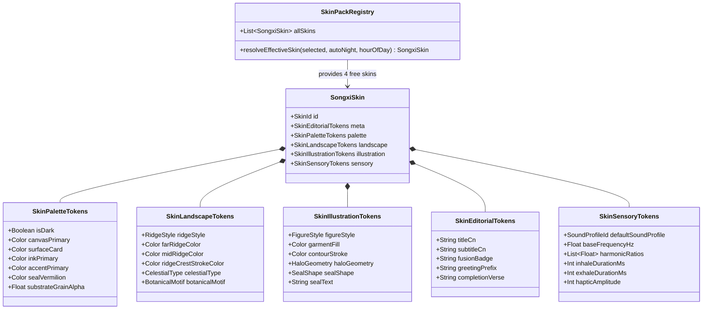
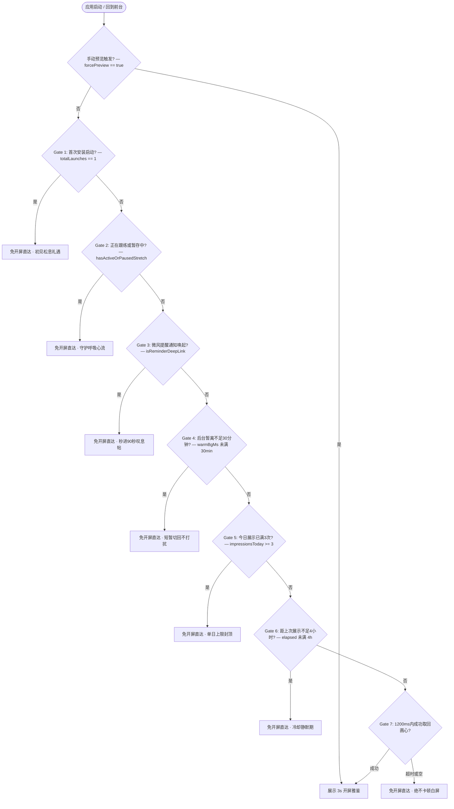
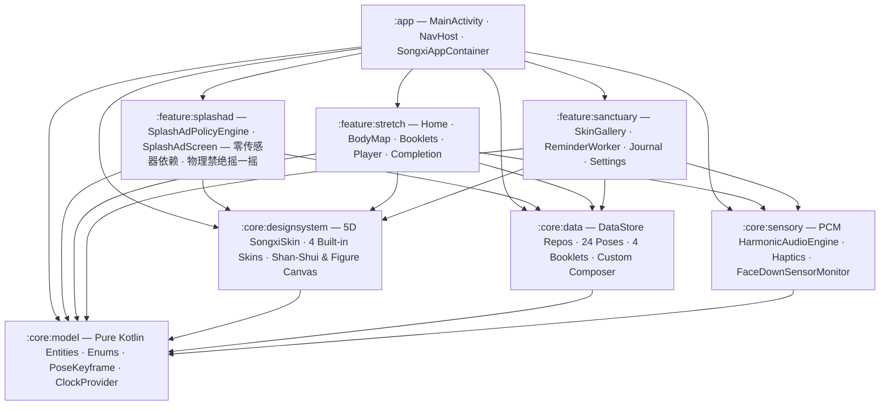

# 「松息 Sōngxī」产品设计方案（v2 · 独立 Android 原生版）

**一松一息，身自舒展 —— 插画 × 中国山水画可替换皮肤 · 低打扰闭眼微拉伸栖居地**

- **工程皮肤与开屏规范**：[SKIN_AND_SPLASH_SPEC.md](file:///home/antigravity/docs/SKIN_AND_SPLASH_SPEC.md)
- **四境皮肤美学参考图谱**：[songxi_skin_gallery_showcase.html](file:///home/antigravity/docs/songxi_skin_gallery_showcase.html)
- **独立 Android 高保真交互原型**：[songxi_interactive_prototype.html](file:///home/antigravity/docs/songxi_interactive_prototype.html)

---

## 一、 品牌定义与核心产品哲学（Brand Identity & Seven Doctrines）

### 1.1 正式品牌定位与核心主张
- **正式品牌名称**：**松息（Sōngxī）** —— *“松开紧绷的身，安顿浮躁的息。”*
- **核心标语**：**一松一息，身自舒展。**
- **产品载体策略**：**独立原生 Android 应用先行**（包名 `com.songxi.app`，Kotlin `2.0.21` + Jetpack Compose `BOM 2024.12.01` 离线优先架构，`minSdk = 26`、`targetSdk = 34`、`compileSdk = 35`），启动即入席，免注册、免登录、本地 `DataStore` 私密存储。
- **视觉与系统核心**：将**当代温润插画风格（近景人体工学拉伸引导）**与**中国传统山水画意境（远山皴染、云霭留白、四时草木、宣绢肌理、朱砂印章）**深度融合，并在系统底层构建**五维可替换皮肤引擎（`SongxiSkin`）**，内置四款气质迥异的免费东方画境。
- **商业与内容承诺**：**零内购门槛、无等级锁限，全功能永久免费开放（100% 永久免费 · 100% 免费，无任何内购分档），应用内全套功法、全部四款山水插画画境与四册雅集全部免费开放**；遵循「只以开屏广告盈利」准则，**只以单页合规克制的 3 秒「开屏雅鉴」（开屏广告）作为唯一商业支持入口**，进入应用内部后清净无染，绝无横幅、信息流、插屏或激励贴片干扰。

### 1.2 久坐办公族的三重劝退与「松息」破局之道

传统运动健身软件把“拉伸”当作高强度训练的附属品，往往将疲惫的办公人群推开。「松息」以东方器物般的温润克制逐一化解久坐痛点：

| 久坐人群真实痛点 | 传统健身产品常见劝退点 | 「松息 Sōngxī」治愈系破局设计 |
| :--- | :--- | :--- |
| **用眼已极度透支** | 全程需死盯屏幕看复杂真人示范与跳动秒表，脖子越看越僵 | **3 秒插画起势 + 余光闭眼跟练**：看清温润插画动作只需 3 秒，随后闭上双眼，凭自然泛音和弦与线性马达呼吸微震完成舒展 |
| **开放工位拘谨尴尬** | 动辄要求铺瑜伽垫、大幅度下犬式或站立踢腿，邻座侧目 | **工位坐姿 · 邻座无感 + 翻转静默**：精选免起身、免脱鞋微幅动作；同事走近时将手机屏幕朝下轻扣桌面，即刻无声暂存跟练 |
| **精力耗竭怕被催促** | 刺耳哨声倒计时、连签排行焦虑、层层弹窗打断心流 | **无连签水纹手札 + 微风轻语**：不设连签统计与名次对比，练完仅在宣纸日历漾开一圈淡墨水纹；午休、夜间与周末自动静默守护 |

> [!IMPORTANT]
> **北极星原则：不过分消耗注意力（Low Attention Tax）**
> 用户打开「松息」时，往往正处于连会间隙或代码编译的疲惫时刻。任何主流程必须在 **2 次轻触以内** 启动；界面保持 **≥ 45% 有效宣绢留白**；引导词像一位温和知己轻声叮嘱（每句严格 **≤ 36 字**），绝不使用生硬生理解剖术语与催促式口令。

---

## 二、 标杆调研与东方宋韵美学合成（Benchmark & Aesthetic Synthesis）

### 2.1 国内外身心健康与东方器物美学标杆矩阵

为打造兼具独立产品品味、高级感与极简实用性的体验，「松息」深度汲取五类标杆产品的交互精髓与东方艺术母题：

| 参考维度 | 标杆样本与艺术母题 | 提炼的设计启发与「松息」转化策略 |
| :--- | :--- | :--- |
| **全画幅呼吸意境** | **潮汐（Tide）** | 摒弃工具化九宫格列表，以全画幅自然声景与日笺诗句承载情绪安顿；转化为「今日一息」山水画卷舞台与「松息日笺」原生分享画片 |
| **副交感连续节律** | **Pause（ustwo × PauseAble）** | 借鉴太极连续缓慢运动触发副交感神经恢复的原理；转化为 **4 秒吸气轻展 + 6 秒呼气沉肩** 的非对称余弦呼吸光晕与泛音包络 |
| **零内疚与闭眼感知** | **Gentler Streak / Pauseture** | 尊重身体休息日、倡导闭眼内观本体感受；转化为*“留白亦是休息”*的无连签水纹月历，以及一键隐去繁杂元素的「闭眼余光态」 |
| **免登录微间歇切入** | **MicroPause / Mini Bend Flow** | 零账号门槛、90 秒至 3 分钟办公桌微间歇即开即练；转化为冷启动免登录直达与首页四枚「片刻救急轻帖」 |
| **宋韵青绿与宣绢器物** | **王希孟《千里江山图》/ 米氏云山 / 宋代汝瓷 /《紫禁城365》** | 提炼石青石绿泥金勾勒、米家泼墨云山、天青冰裂纹釉色与朱文白文闲章，确立 **60 / 25 / 10 / 5 宋代矿物设色比例** |

### 2.2 「远山写意 × 近人亲和」五层空间解耦法则

古典山水画中的“点景人物”往往渺小难辨，而纯扁平现代插画又缺乏东方气韵的纵深呼吸感。「松息」独创**五层空间与感官解耦架构**，让山水意境与人体工学引导各司其职、浑然一体：

1. **第一层 · 宣绢器物基底（60% 留白底色）**：生宣草木纤维、天青熟绢经纬、苍墨松烟微砂、暖桑皮纸肌理，彻底拒绝刺眼纯白极值与死寂纯黑极值。
2. **第二层 · 远山云霭与四时草木（25% 意境纵深）**：远景山峦皴染、中景缓流云带与边角苍松、翠竹、弦月、春桃折枝，营造推窗见山的呼吸纵深。
3. **第三层 · 当代温润人体插画与呼吸光晕（核心前景）**：采用丰盈棉麻/汝瓷/暖陶衣褶平涂与书法提按轮廓线描绘半身舒展人物，眉目轻阖安详，3 秒内即可一眼领会肩颈脊柱发力方向；背后衬以随呼吸舒张的专属几何光晕。
4. **第四层 · 金石朱砂印章与宋刻雅字（5% 点睛气韵）**：每款皮肤配属专属印式（朱文方印、白文长印、葫芦闲章、圆朱文印）与微宽字距宋体题跋。
5. **第五层 · 离线物理泛音与微震包络（闭眼声景）**：原生 `AudioTrack` 实时合成颂钵、竹磬、古琴、春雨自然泛音列，配合 `VibrationEffect` 呼吸微震，支撑全程闭眼盲跟。

---

## 三、 目标人群画像与一日五息微场景流（Personas & Daily Flow）

### 3.1 三类核心久坐人群画像
1. **深度伏案创作者（24–38 岁 · 研发工程师 / 设计师 / 撰稿人）**
   - *身体状态*：日均凝视屏幕 9 小时以上，枕下肌群紧绷、圆肩探颈、右手鼠标腕酸涩、眼周干胀。
   - *核心诉求*：不打断思绪流，在编译等待或保存文档的 2 分钟里闭眼温目、松开后颈风池。
2. **高频会议沟通者（26–42 岁 · 产品负责人 / 咨询顾问 / 运营主管）**
   - *身体状态*：连续语音或线下会议导致无意识耸肩屏息、斜方肌僵硬如石、午后胸闷乏力。
   - *核心诉求*：两场会议之间仅剩 90 秒，需坐姿隐蔽完成“双吸长叹沉肩”，遇到同事随时优雅静默暂存。
3. **审美敏感的慢生活向往者（25–45 岁 · 文化创意人 / 教师 / 独立工作者）**
   - *身体状态*：久坐腰骶酸沉，睡前交感神经持续亢奋难以入眠，对粗制滥造的工具界面极其敏感。
   - *核心诉求*：偏爱青绿山水与晚间沉香琴韵画境，睡前在床沿伴随 4 吸 6 呼温和解绑腰背。

### 3.2 一日五息自然场景流

---

## 四、 十五项核心功能与全链路交互体验（Complete `F1`–`F15` UX Architecture）

「松息」围绕五个一级栖居空间（`今日一息`、`寻音雅集`、`山居画境`、`松息手札`、`微风设置`）与两个沉浸层（`开屏雅鉴`、`闭眼跟练与一息成`）展开，完整覆盖 15 项核心特性：

| 编号 | 功能模块 | 核心体验与工程要点 |
| :---: | :--- | :--- |
| **F1** | 零登录本地栖居与温和初见 | 冷启动即用，零账号体系、零手机号/邮箱输入框；首次打开呈递非遮挡式「初见松息」温和说明卡，阐明本地私密存储与单一开屏理念 |
| **F2** | 装裱级「开屏雅鉴」与安全跳转 | `78%` 宣绢装裱器物画心 + `22%` 品牌印章底栏；清晰标注 `广告 · 开屏雅鉴`、`0ms` 即刻可点 `≥48dp` `跳过 3s`、背景点击静默无响应、底部胶囊按钮二次确认弹窗、静音且**硬件级禁用摇一摇** |
| **F3** | 七重克制频控与隐私透明控制 | 首启免打扰、跟练中免打扰、微风提醒直达免开屏、`<30分钟` 热切换免开屏、单日 `≤3次` 上限、`≥4小时` 冷却间隔、`1200ms` 超时优雅跳过；支持个性化推荐开关与一键「预览开屏雅鉴」 |
| **F4** | 全功能永久免费开放体系 | 四款主题画境、四册四时雅集、六区无限次身体寻音配帖、五种声景及手札日笺全部免费开放，应用内零内购锁限、零内嵌广告 |
| **F5** | 五维插画 × 山水可替换皮肤引擎 | `SongxiSkin` 统一驱动色彩肌理、远山云霭背景、人体插画与光晕印章、节气宋体文案、物理泛音与微震五组令牌 |
| **F6** | 四款免费画境、实时换肤与昼夜随顺 | 内置 `水墨远山`、`青绿山居`、`暮山听松`、`春涧花影`；零重启即点即换、支持泛音试听、`DataStore` 持久化及 `20:00–08:00` 自动切换 `暮山听松` |
| **F7** | 「今日一息」情境首页与救急轻帖 | 动态山水画眉、节气问候、快捷皮肤徽章、三档场景切换（`工位坐姿 / 桌边茶歇 / 晚间床沿`）、一键「开始一息」主卡及四枚 `90s–3m` 片刻救急轻帖 |
| **F8** | 六区身体寻音与无限「一秒成方」 | 东方线描气韵人形图支持 `后颈风池 / 双肩斜方 / 胸椎圆肩 / 下腰久坐 / 手腕鼠标侧 / 眼周眉心` 1–3 区多选，搭配 `2 / 4 / 6 分钟` 无限次即时组方 |
| **F9** | 「四时雅集」四册免费温和专册 | 《伏案颈胸开阔记》《久坐腰骶归位帖》《晚间呼吸解绑》《屏幕温目护腕册》四册线装感专册全部开放，本地记录进度，随时暂歇续练亦无妨 |
| **F10** | `4s/6s` 呼吸光晕与「闭眼余光态」 | 插画人物随 `4000ms` 吸气轻展 / `6000ms` 呼气沉肩平滑插值；一键开启「闭眼余光态」柔化前景；支持上一式、下一式、暂歇继续及常亮防息屏 |
| **F11** | 离线泛音合成、呼吸微震与翻转静默 | 合成 `432Hz 颂钵 / 528Hz 竹磬 / 396Hz 古琴 / 440Hz 春雨` 与 `静默仅微震`；跟练页独占重力感应实现手机扣放桌面「翻转静默暂存」 |
| **F12** | 「一息成」水纹回响与体感轻记 | 末式完成绽放同心水纹与画境专属诗句，支持可选点选 `肩颈轻快 / 温热舒展 / 心神安宁`（亦可直接完成），防连点幂等写入手札 |
| **F13** | 「微风提醒」低打扰久坐守护 | `WorkManager` 周期提醒（`45 / 60 / 90 / 120 分钟`），支持每日上限、午休勿扰（`12:00–13:30`）、夜间勿扰（`20:00–09:00`）、周末静默、今日勿扰及通知一键免开屏直达 `90s` 叹息帖 |
| **F14** | 「松息手札」无连签水纹月历与日笺 | 宣纸月历以淡青/松烟水纹记录每次舒展，汇总 `本月留白 X 息 · 舒展 Y 分钟`，无连签计数压力；支持生成「松息日笺」调用 Android 原生系统分享 |
| **F15** | 独立 Android 签名包与多端设计同步 | 产出 `assembleDebug` 与签名 `assembleRelease` APK（仅申请 `VIBRATE` 与 `POST_NOTIFICATIONS` 权限）、Roborazzi 四皮肤渲染基准图及高保真原型套件 |

### 4.1 关键交互细节深描

1. **温和不挡路的「初见松息」礼序（`F1`）**：
   首次安装启动时，首启保护门禁自动跳过开屏页，直接展现「今日一息」山水主舞台。页面上方内嵌一张温润的「初见松息」素笺卡片（绝非阻断全屏手势的强弹窗），轻点「入席松息」即可收起，用户亦可直接点击下方「开始一息」或任意底部导航栏，真正做到零门槛入席。
2. **六区「身体寻音」与「四时雅集」合一舞台（`F8, F9`）**：
   在「寻音雅集」页，上半卷为温润东方人形气韵图，点选 1 至 3 处酸沉部位（如 `后颈风池` + `双肩斜方`）并选择 `2 / 4 / 6 分钟`，算法自动从 24 式人体工学动作库中均衡抽取匹配体式并精准配平总时长；下半卷陈列四册线装专册，无任何锁头图标，每一日皆可反复温习。
3. **3 秒看清，全程闭眼的跟练器细节（`F10, F11, F12`）**：
   进入跟练页后，主舞台中央的插画人物随 **4 秒吸气（`吸气 · 轻展`）→ 6 秒呼气（`呼气 · 沉肩`）** 连续舒展肩颈与双臂，底部配有五档声景胶囊。开启「闭眼余光态」后，界面文字收敛为柔和呼吸余光，即使手机放在桌角，眼角余光与指尖微震亦能感知节律。

> [!TIP]
> **工位防尴尬巧思 ——「翻转静默暂存」**：
> 当同事突然走近工位讨论工作时，无需手忙脚乱寻找暂停键，只需顺手将手机**屏幕朝下轻扣在桌面**（重力传感器 `Z ≈ -9.5 m/s²`，且该传感器监听器严格仅在跟练页存活，退出跟练立即注销），泛音与计时即刻静默暂存；待交谈结束拿起手机，即可从容续接刚才的那一息。

---

## 五、 五维可替换皮肤系统架构（5D `SongxiSkin` Illustration × Shan-Shui Engine）

### 5.1 系统级主题解耦类图

为满足“插画风格与中国山水画融合，并在系统架构上原生支持可替换皮肤”的核心要求，主题系统绝非简单的深浅色切换，而是通过不可变聚合契约 `SongxiSkin` 与 `CompositionLocal`（原型端对应 `.songxi-app-shell[data-skin]` 作用域变量与 `SongxiRenderCore` 矢量引擎）同步驱动五个维度：

### 5.2 内置四款永久免费画境全景矩阵（均通过 WCAG 2.1 AA/AAA 对比度校准）

| 维度 / 令牌 | `ink_mist` **水墨远山 · 素宣**（默认日间） | `qinglv_celadon` **青绿山居 · 汝瓷**（传世重彩） | `dusk_pine` **暮山听松 · 沉香**（夜间低眩光） | `spring_blossom` **春涧花影 · 暖陶**（春和温养） |
| :--- | :--- | :--- | :--- | :--- |
| **融合配比气质** | 六分半宋人水墨 · 三分半现代插画 | 五分青绿山水 · 五分现代插画 | 五分半暮山烟岚 · 四分半微光插画 | 三分半春涧山水 · 六分半草木插画 |
| **A. 画布宣绢底色** | `#F5F1E8`（手工生宣） | `#EEF3EE`（天青熟绢） | `#19201E`（苍墨夜山） | `#F8F1EA`（暖桑皮纸） |
| **A. 器物卡片底色** | `#FAF7F1` / `#ECE6DA` | `#F7FAF7` / `#E3EDE7` | `#232D2A` / `#1D2623` | `#FDF9F5` / `#EFE4DA` |
| **A. 主墨色与对比度** | `#262B28`（松烟墨 `12.77:1` AAA） | `#1E2E2B`（黛青墨 `12.62:1` AAA） | `#E6E1D6`（素绢暖白 `12.71:1` AAA） | `#322926`（紫砂茶墨 `12.67:1` AAA） |
| **A. 次墨与主矿物色** | `#5C645F` / `#486356`（苍葭青） | `#4F635E` / `#35685C`（石绿青瓷） | `#A6B2AB` / `#86AA96`（竹月清辉） | `#685A54` / `#9B5A49`（暖陶赭粉） |
| **B. 远山皴法与草木** | 米氏泼墨层峦 + 云霭 + 苍松斜枝 | **千里江山石青石绿 `#B88655` 泥金勾峰** + 翠竹湖石 | 暮山苍靛远岫 + 弦月清辉 + 暮松针影 | 春涧缓坡 + 蜿蜒碧溪 + 山桃折枝 |
| **C. 插画衣冠与描边** | 亚麻素衣平涂 + `2.2dp` 书法提按墨线 | 汝瓷天青衫 + 泥金领缘 + `1.5dp` 铁线描 | 沉香松青袍 + `1.8dp` 竹月微光轮廓线 | 暖杏水粉衣衫 + 碧色袖缘 + `1.7dp` 柔线 |
| **C. 呼吸光晕与印章** | 水墨同心涟漪 · 朱文方印「`松息`」 | 青绿云肩如意气 · 白文长印「`山居清息`」 | 竹月潮汐弦环 · 葫芦闲章「`听松`」 | 六瓣花影舒张 · 圆朱文印「`春山`」 |
| **D. 首页问候与结语** | 远山淡影 · 宜沉肩缓息 *“一息墨韵散，肩头万事轻。”* | 青绿山居 · 宜开胸纳气 *“身如青山立，清风入袖来。”* | 暮山听松 · 宜敛神松腰 *“松风吹解带，夜静息自宁。”* | 春涧花影 · 宜舒腕温目 *“眉间春水暖，指下花影轻。”* |
| **E. 默认泛音声景** | `432Hz` 温润颂钵 `[1.0, 1.5, 2.74]` | `528Hz` 空谷竹磬 `[1.0, 2.0, 3.16]` | `396Hz` 松风琴韵 `[1.0, 1.5, 2.0, 3.0]` | `440Hz` 春涧细雨 `[1.0, 1.68, 2.5]` |

- **昼夜随顺换境机制（`resolveEffectiveSkin`）**：当用户在「山居画境」开启「昼夜随顺换境」开关后，每逢本地时间 **`20:00` 至次日 `07:59`**，系统自动平顺切换至低眩光护眼的 `暮山听松（dusk_pine）`；晨间 **`08:00` 至 `19:59`** 自动恢复用户所选的日间画境（如 `青绿山居`），体贴守护夜间褪黑素节律。

---

## 六、 纯粹「开屏雅鉴」商业化架构与合规守护（Splash-Ad-Only Monetization）

### 6.1 「一门雅鉴，入室无尘」版式美学

「松息」以单一开屏展示支撑独立研发与长期免费开放，彻底摒弃喧宾夺主的商业化套路，将开屏设计为如博物馆册页扉页般的**「开屏雅鉴」**：

- **黄金分割立轴构图**：
  - **上卷 `78%` 宣绢装裱画心（`splash_ad_backdrop`）**：四周内缩 `16dp` 留出当前皮肤底色装裱边，圆角 `24dp` 细线装池；仅甄选东方茶器、天然草木线香、人体工学案头木作等契合静心审美的器物画作（内置三幅矢量雅鉴画心：`山茗器物 · 汝瓷茶席`、`松间闻香 · 草木线香`、`案头清风 · 胡桃木护颈架`，并预留 `SdkSplashAdBridgeProvider` 标准桥接接口）。
  - **下卷 `22%` 品牌印章静心底栏（`splash_ad_brand_footer`）**：镌刻当前皮肤朱砂印章、「松息 Sōngxī」宋刻字标与*“一松一息，身自舒展 · 全功能永久免费开放”*承诺。

### 6.2 工信部规范、广告法与个人信息保护六重反套路保障

| 合规与体验维度 | 行业常见恶劣乱象 | 「松息 · 开屏雅鉴」硬件与交互级守护准则 |
| :--- | :--- | :--- |
| **清晰显著标识** | 把“广告”二字做成极小半透明浅灰字藏在角落 | 左上角常驻高对比度（`≥ 4.5:1`）素笺胶囊标签 **`广告 · 开屏雅鉴`**（`splash_ad_badge`） |
| **零延迟大热区跳过** | 伪造假跳过按钮、倒计时前 2 秒隐藏或触控区极小 | **`t = 0ms` 首帧即刻可见可点**，右上角跳过胶囊尺寸严格 **`≥ 48dp × 48dp`**，清晰倒数 `跳过 3s → 跳过 2s → 跳过 1s` |
| **防误触静默画心** | 全屏任意位置轻碰即强行唤起第三方应用 | **`splash_ad_backdrop` 画心区域点击 100% 静默无响应**；仅限底部独立胶囊按钮（`splash_ad_cta_button`）可触发详情 |
| **外部跳转二次确认** | 误点瞬间直接跳出应用甚至自动下载安装包 | 点击底部胶囊按钮先暂停倒计时并弹出 **`splash_ad_confirm_sheet` 温和确认层**，展示摘要与「返回松息 · 不跳转」按钮 |
| **硬件级杜绝摇一摇** | 高灵敏度陀螺仪“摇一摇/扭一扭”走路微晃即误跳 | **架构级物理隔离**：`:feature:splashad` 模块在 Gradle 依赖层**严禁依赖 `:core:sensory` 或注册任何 `SensorManager` 监听器**，全程静音无声 |
| **隐私透明与自主预览** | 默认开启跨应用追踪且深藏关闭开关 | 遵循最小必要原则，「个性化开屏推荐」默认关闭（展示情境器物画心）；设置页提供一键「预览开屏雅鉴」供用户随时审阅 |

### 6.3 七重克制频控决策引擎（`SplashAdPolicyEngine`）

为确保开屏绝不破坏办公急救与静心体验，`SplashAdPolicyEngine` 按严格优先级执行七道门禁：

---

## 七、 独立 Android 原生工程架构与验证路线图（8-Module Compose Blueprint）

### 7.1 八模块无环依赖架构图（`/home/antigravity/songxi-android`）

采用轻量级构造器依赖注入（`SongxiAppContainer` + `CompositionLocal`），零注解处理器膨胀，严格保证模块职责边界与传感器隔离：

> [!NOTE]
> **极简权限与契约同构设计**：
> `AndroidManifest.xml` 仅声明 `android.permission.VIBRATE`（呼吸微震）与 `android.permission.POST_NOTIFICATIONS`（微风久坐轻语）两项温和权限，绝不索取通讯录、位置、相机、麦克风、电话状态或悬浮窗权限。同时，Android Compose `Modifier.testTag` 与高保真交互原型 `data-testid` 保持 **89 项语义节点 1:1 严格同构**。

### 7.2 四阶段工程交付与质量验证矩阵

| 阶段 | 核心交付范围 | 自动化与视觉验收门禁 |
| :--- | :--- | :--- |
| **阶段一 · 领域模型与感官底座** | `:core:model`、`:core:data`（24 式微拉伸库、三景主方、四救急帖、四雅集、`DataStore` 仓储）、`:core:sensory`（离线 PCM 泛音合成、微震包络、跟练独占翻转监测） | 单元测试验证 `PoseKeyframe` 插值、配帖时长精确归一化与静默时段边界 |
| **阶段二 · 五维画境与开屏雅鉴** | `:core:designsystem`（四款免费 `SongxiSkin`、山水/插画人物/穴位/光晕/印章 Canvas 渲染器）、`:feature:splashad`（7 重频控引擎、装裱式开屏页） | WCAG AA/AAA 对比度校验、Roborazzi 四皮肤像素差异快照、开屏零传感器校验 |
| **阶段三 · 跟练心流与山居栖居** | `:feature:stretch`（今日一息、身体寻音、四时雅集、`4s/6s` 闭眼跟练、一息成）、`:feature:sanctuary`（山居画境、微风提醒、松息手札与日笺）及 `:app` 集成签名 | `assembleDebug`、签名 `assembleRelease`、`lintDebug` 零错误构建与 APK 权限纯净审计 |
| **阶段四 · 全链路黑盒 E2E 签收** | 独立 Android 应用与高保真 Web 原型双表面四层黑盒验收（功能路径、边界异常、跨特性正交组合、真实办公全天剧本） | 累计 **≥ 180 项自动化 E2E 用例 100% 通过**，高分屏与移动端零溢出视觉走查通过 |
